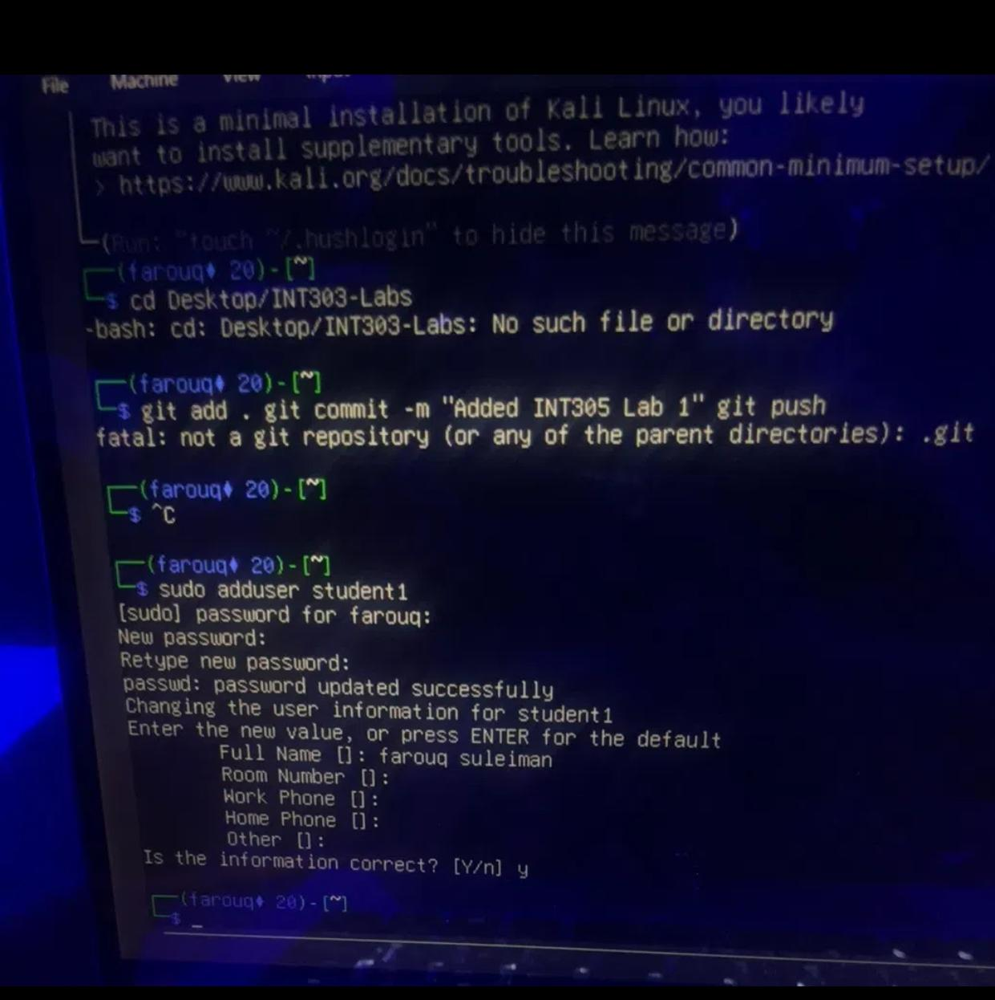

# INT305: Network Security and Protocols - Lab 1
Student Name: Farouq

## 1. Steps Taken
   Create: Used sudo adduser student1 to create the account.
   Modify: Used sudo groupadd students and sudo usermod -aG students student1 to add the user to a group. Changed the password with sudo passwd student1.
Lock: Checked for active processes (ps -u student1) and locked the account with sudo usermod -L student1.
Unlock: Unlocked the account with sudo usermod -U student1.
Delete: Removed the user and their home directory using sudo deluser --remove-home student1.

)

## 2. Challenges Encountered
The main challenge was ensuring that when deleting the user, I completely removed their home directory to prevent leaving orphaned files on the system. I addressed this by using the --remove-home flag with the deluser command.

## 3. Insights Gained
I learned the complete lifecycle of a Linux user account. Proper user management is the first line of defense in operating system security. Locking or deleting accounts immediately when they are no longer needed prevents unauthorized access, and using groups simplifies permission management.
