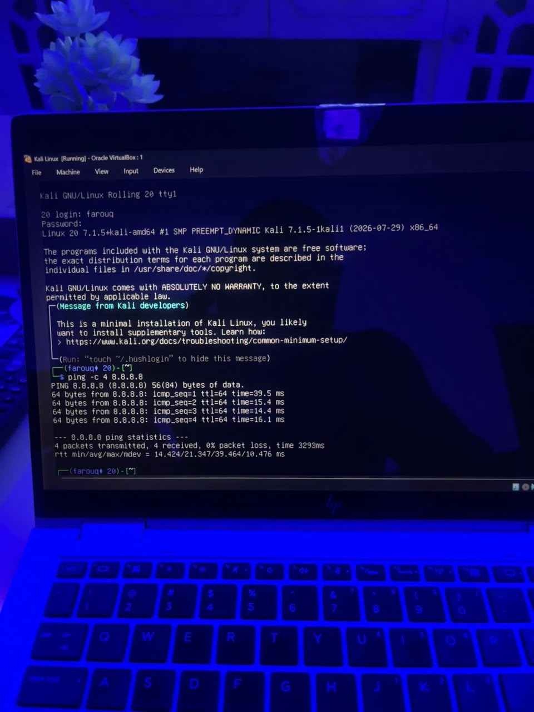
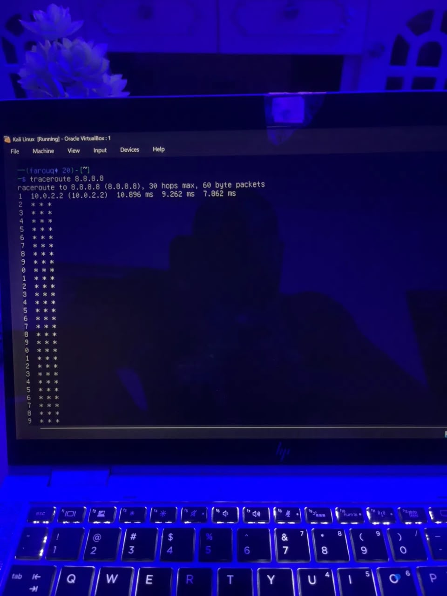
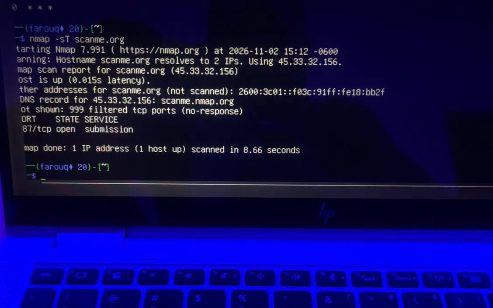
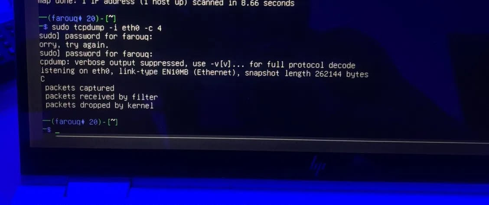

# INT303 Lab 1: Network Fundamentals
Student Name: Farouq

## Exercise 1: OSI and TCP/IP Models
   OSI Layers: Application, Presentation, Session, Transport, Network, Data Link, Physical.
   Mapping: TCP/IP Application = OSI App/Pres/Session. TCP/IP Transport = OSI Transport. TCP/IP Internet = OSI Network. TCP/IP Link = OSI Data Link/Physical.

## Exercise 2: Ping

   Process: Sends ICMP Echo Request; target replies with Echo Reply.

## Exercise 3: Traceroute

   Significance: Identifies routers along the path. (My output showed 1 hop to the gateway).

## Exercise 4: Active Connections
   Connections: ESTABLISHED TCP connection visible in terminal.
   Transport Layer: TCP ensures reliable delivery.

## Exercise 5: TCP vs UDP

   Differences: TCP is reliable; UDP is fast/connectionless.
   Services: My Nmap scan found port 87/tcp open.

## Exercise 6: ARP
   MAC Address: 08:00:27:xx:xx:xx (Default VirtualBox MAC)
   Significance: Translates IPs to MAC addresses for local network delivery.

## Exercise 7: Tcpdump

   Protocols: ICMP, TCP.
