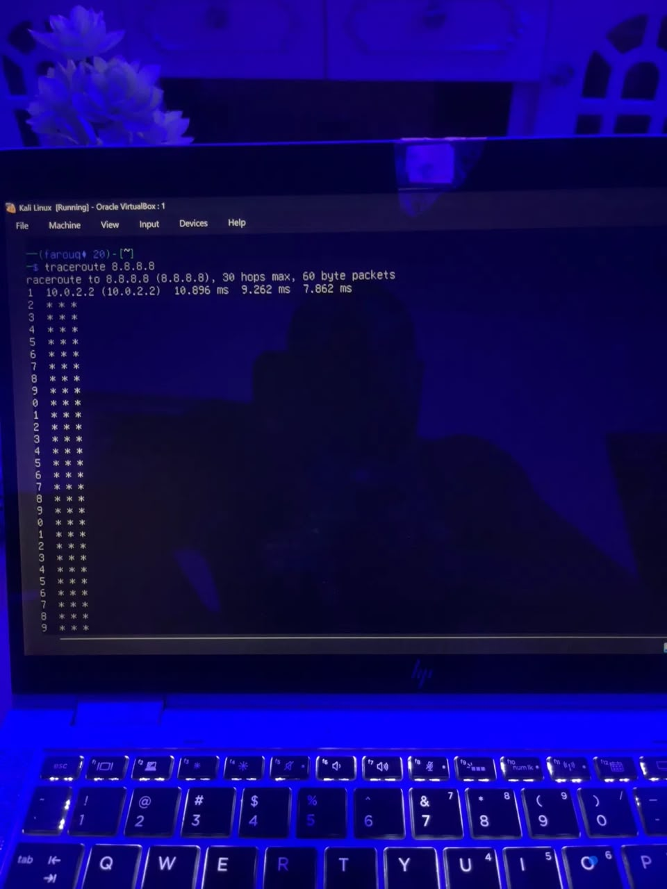
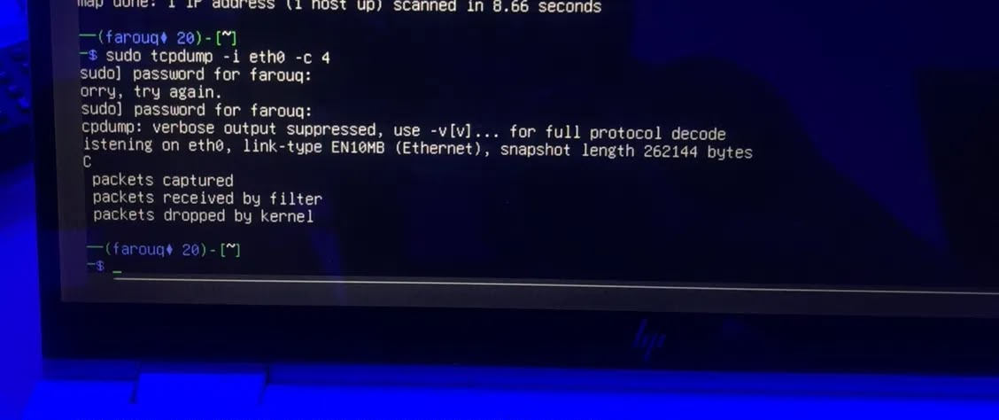

# INT303 Lab 4: Routing and VLANs
Student Name: Farouq

## Exercise 1: Static Routing
   How it works: Manually adds routes to the kernel table.
   Challenges: Human error, no automatic failover.

## Exercise 2: Namespaces (VLANs)
   Simulation: Isolated network stacks connected by virtual veth cables.
   Benefits: Security isolation, testing without hardware.

## Exercise 3: Subnetting
   How it works: Subnet mask determines local vs. remote routing.
  Challenges: IP conflicts, mask calculation errors.

## Exercise 4: Ping & Traceroute

   Traceroute: Shows path and latency per hop to pinpoint drops.
   Performance: Fewer hops = faster. Congestion = high latency.

## Exercise 5: iptables
   Functionality: IP forwarding routes traffic; iptables filters it.
    Mistakes: Wrong rule order, forgetting to save.

## Exercise 6: tcpdump

   Diagnosis: Verifies traffic flow and inspects headers.
   Traffic: Observed ICMP traffic through virtual interfaces
