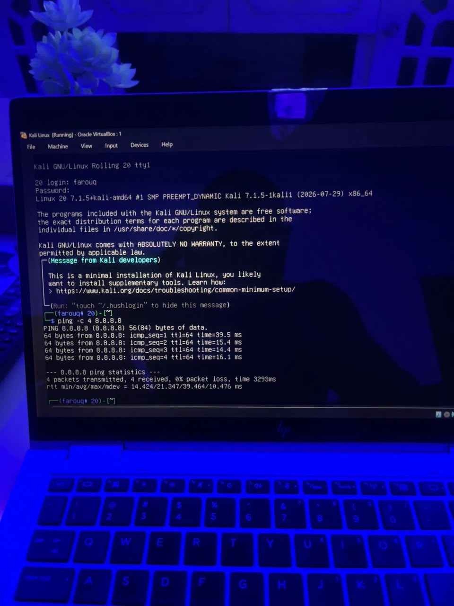
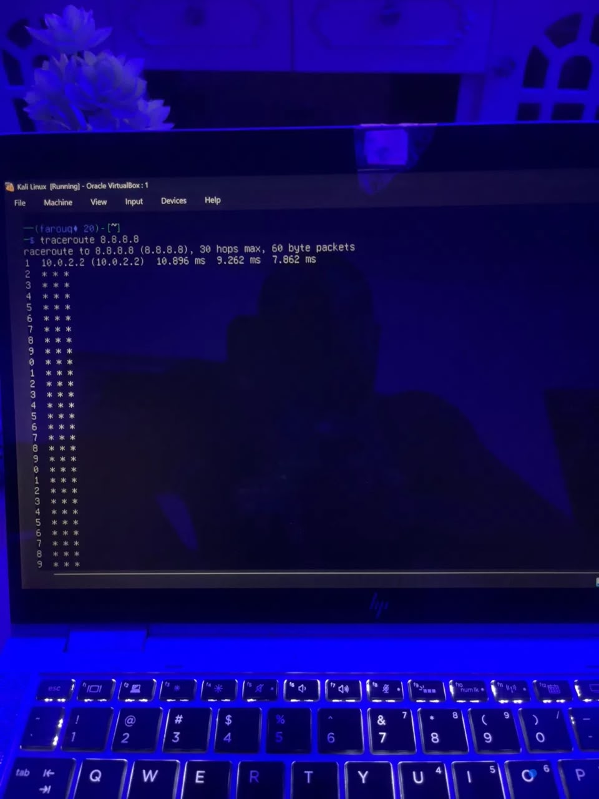

# INT303 Lab 5: IP Address Analysis
Student Name: Farouq

## 2. Website List & Classification

   google.com: 142.250.190.46 (Class B)
   facebook.com: 157.240.22.35 (Class B)
   youtube.com: 142.250.190.78 (Class B)
   twitter.com: 104.244.42.1 (Class A)
   apple.com: 17.253.144.10 (Class A)

## 3. IP Class Characteristics
   Class A (1-126): Massive networks.
   Class B (128-191): Medium/large networks.
   Class C (192-223): Small networks.

## 4. Devices Supported (2^n - 2)
   Class A: 16,777,214 hosts.
   Class B: 65,534 hosts.
   Class C: 254 hosts.

## 5. Subnet Masks
   Default: Class A (/8), Class B (/16), Class C (/24).
   Custom (/26): Creates 4 subnets with 62 usable hosts each.

## 6. Advanced Tools

traceroute reveals the path to a destination. Early hops are local ISPs; final hops are cloud infrastructure.

## 7. Conclusion
IP management and subnetting are vital for efficient network design, security, and scalability.
